## Links para plataformas digitais e download dos programas

- **Notepad++** — <https://notepad-plus-plus.org/downloads/>
- **GenBank** — <https://www.ncbi.nlm.nih.gov/genbank/>
- **Sequence Matrix** — <http://gaurav.github.io/taxondna/>
- **AliView** — <http://ormbunkar.se/aliview/>
- **MAFFT Server** — <https://mafft.cbrc.jp/alignment/server/>
- **Gblocks** — <http://phylogeny.lirmm.fr/phylo_cgi/one_task.cgi?task_type=gblocks>
- **PGDSpider** — <http://www.cmpg.unibe.ch/software/PGDSpider/>
- **jModelTest2** — <https://github.com/ddarriba/jmodeltest2>
- **MEGA 11** — <http://www.megasoftware.net/>
- **PHASE v. 2.1.1** — <http://stephenslab.uchicago.edu/phase/download.html>
- **SeqPHASE** — <https://eeg-ebe.github.io/SeqPHASE/>
- **Indelligent v. 1.2** — <http://dmitriev.speciesfile.org/indel.asp>
- **DnaSP v. 6** — <http://www.ub.edu/dnasp/>
- **TOPALi v. 2** — <http://www.topali.org/>
- **SplitsTree4** — <http://software-ab.cs.uni-tuebingen.de/download/splitstree4/welcome.html>
- **Mesquite** — <http://mesquiteproject.org/>
- **PopART** — <http://popart.maths.otago.ac.nz/>
- **Pacote BEAST2** — <http://www.beast2.org/>
- **Tracer** — <https://github.com/beast-dev/tracer/releases/tag/v1.7.2>
- **FigTree** — <http://tree.bio.ed.ac.uk/software/figtree/>
- **R** — <https://www.r-project.org/>
- **Rtools** — <https://cran.r-project.org/bin/windows/Rtools/>
- **RStudio** — <https://www.rstudio.com/>
- ***b*GMYC** — <https://sites.google.com/site/noahmreid/software>
- ***splits*** — <https://r-forge.r-project.org/R/?group_id=333>
- **mPTP web server** — <https://mptp.h-its.org/#/tree>
- **Structure** — <https://web.stanford.edu/group/pritchardlab/structure.html>
- **Structure Harvester** — <http://taylor0.biology.ucla.edu/structureHarvester/>
- **CLUMPP** — <https://rosenberglab.stanford.edu/clumpp.html>
- **distruct** — <https://rosenberglab.stanford.edu/distruct.html>
- **BPP** — <http://abacus.gene.ucl.ac.uk/software.html>
- **iBPP** — <https://github.com/cecileane/iBPP/blob/master/man/winexe.md>
- **Geneland** — <https://github.com/gilles-guillot/Geneland>

## 1. PHASE

O PHASE é um algoritmo de estimativa das fases haplotípicas de fragmentos gênicos heterozigotos. As fases são estimadas por comparação com os indivíduos homozigotos.

Para realizar esta tarefa, você vai precisar de:

1. As sequências de cada um dos marcadores nucleares separadas, alinhadas e em formato FASTA;
2. O arquivo executável do programa PHASE;
3. Acesso à internet para o uso da plataforma web SeqPHASE. Esta plataforma trabalha em dois passos. (1) Ela converte seu arquivo FASTA nos formatos de input do PHASE. (2) A partir dos outputs da análise, o SeqPHASE reconverte os resultados em arquivos FASTA.

### Passo-a-passo

1. Abra o link do SeqPHASE, clique em “Step 1” e carregue seu arquivo FASTA na opção “genotypes to be phased”. Clique em “Run SeqPhase”.

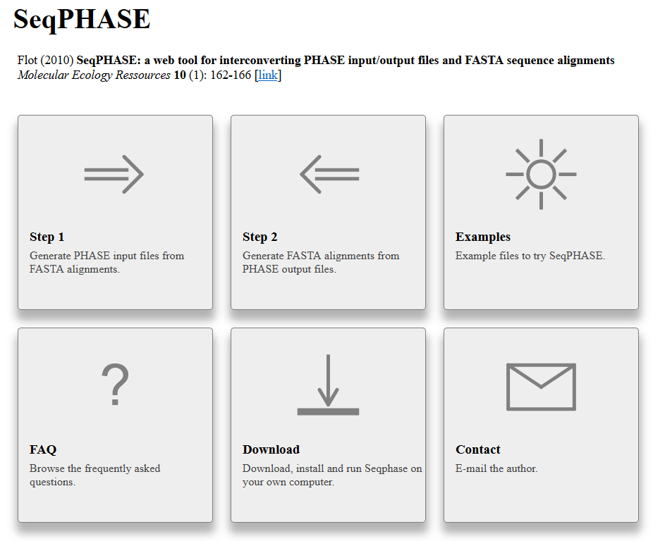

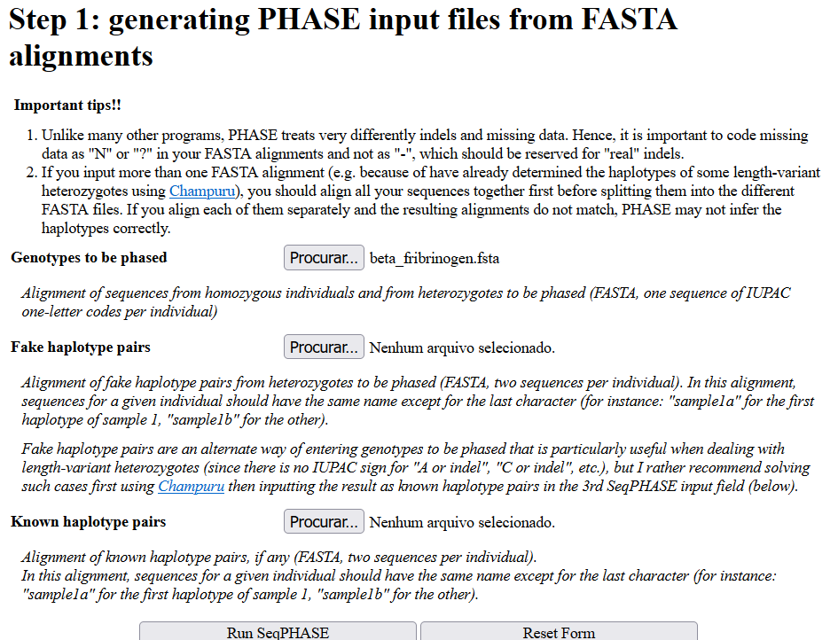

2. Salve os dois arquivos resultantes da conversão (.inp e .const). Esta etapa é importante, pois você vai precisar do arquivo ‘.const’ para reconverter seus resultados em FASTA.

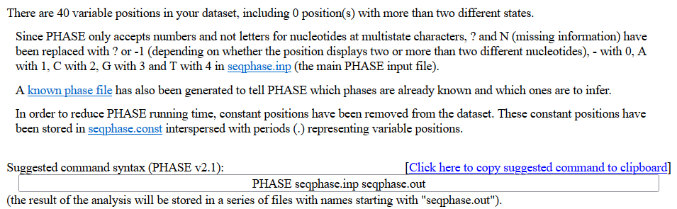

3. Abra o prompt de comando do Windows e arraste o arquivo PHASE.exe para dentro dele. Arraste também o arquivo .inp, dê um nome para o output (.out). Nós utilizaremos a sintaxe sugerida pelo SeqPHASE (figura acima). Por default, o PHASE considera resolvidos apenas os haplótipos com PP > 0,9. Entretanto, nós utilizaremos um limiar de probabilidade de 70% para aceitar as fases haplotípicas estimadas como corretas (ver **Garrick *et al*., 2010. Nuclear gene phylogeography using PHASE: dealing with unresolved genotypes, lost alleles, and systematic bias in parameter estimation. *BMC Evolutionary Biology*, 10: 118**). Para isso, nós utilizaremos a opção `-p0.7`.

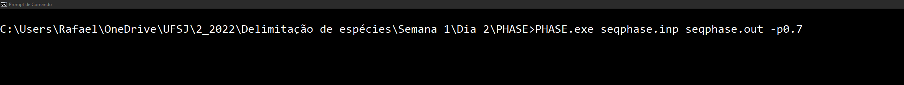

4. Após terminar a rodada, serão gerados vários arquivos de output. Dentre eles, dois são importantes. O arquivo *.out* possui o consenso das rodadas (haplótipos com PP < 0,7 têm as posições heterozigóticas mantidas). O arquivo *.out_pair* lista todos os pares de fases haplotípicas recuperados e a probabilidade de cada par. Abra o SeqPHASE, step 2, carregue os arquivos *.const* e *.out*, desmarque a opção ‘Reduce sequences’ e clique em ‘Run SeqPHASE’. Após a conversão, clique em ‘Click here to download the generated Fasta file’.


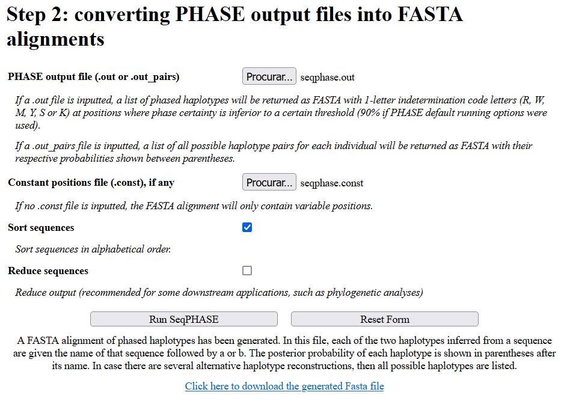

Pronto! Você já possui as fases haplotípicas dos genes nucleares reconstruídas.

> [!TIP]
> **Bonus!** Se os cromatogramas das suas sequências têm quase todas as posições formadas por heterozigotos a partir de um certo ponto, não se desespere. Suas sequências não estão ruins. O que acontece é que as duas cópias haplotípicas são heterozigotas para inserções e deleções (indels). A solução é fácil! Adicione manualmente os códigos das posições heterozigotas (p. ex., M para C e A) e submeta sua sequência à ferramenta on-line **Indelligent**. Esta ferramenta realiza o faseamento de haplótipos heterozigotos para indels e utiliza um algoritmo diferente do PHASE.

## 2. Testes de Recombinação

A maioria dos modelos coalescentes com os quais vamos trabalhar neste curso possuem pressupostos. Um deles é a ausência de recombinação nos fragmentos gênicos. Neste curso, vamos aprender a realizar dois destes testes. O primeiro deles é o teste da diferença da soma dos quadrados (DSS) e o outro é o teste Φ de recombinação.

Para realizar esta tarefa, você vai precisar de:

1. As sequências de cada um dos marcadores nucleares alinhadas e em formato FASTA (assume-se que o genoma mitocondrial de metazoários não sofre recombinação);
2. Os programas TOPALi e SplitsTree4 instalados no seu computador.

### 2.1 Diferença da soma dos quadrados (DSS)

**Passo-a-passo**

1. No TOPALi, clique em ‘File > Import Alignment’ e carregue o seu alinhamento em formato FASTA através da opção “by using an existing file on disk that already contains aligned DNA or protein”;
2. Com o alinhamento aberto, clique em ‘Analysis > Recombination > DSS Analysis...’. A seguinte janela será aberta:

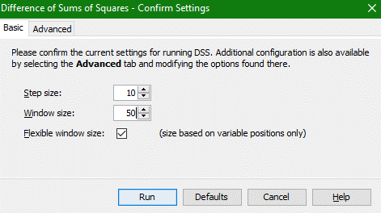

**Step size** é a extensão (em nucleotídeos) que o algoritmo utilizará para mover ao longo do alinhamento. **Window size** são as extensões de sequência que o algoritmo analisará em busca de pontos de recombinação. Quanto menor o ‘window size’, mais rigorosa é a análise, mas a chance de ocorrer erro do tipo II (i.e., rejeitar a hipótese nula de ausência de recombinação quando ela é verdadeira) também é alta. Se o seu fragmento é muito pequeno (<400 pb) é improvável que você encontre evidência de recombinação, mas conduzir o teste é uma etapa mandatória para a verificação do ajuste dos dados à premissa dos métodos coalescentes. Na aba ‘Advanced’ você pode configurar o limite de bootstrap, o modelo de substituição de nucleotídeos (entre JC69 e F84), o número de passos da análise e o limiar de gaps. Deixe tudo como está. Configure o ‘step size’ em 10, o ‘window size’ em 20, marque a caixa “Flexible window size” e clique em ‘Run’.

3. Ao terminar a análise, será gerado um gráfico de DSS ao longo do alinhamento. O eixo de x representa as posições nucleotídicas, enquanto o eixo de y representa os valores de DSS. A curva azul representa os valores de DSS calculados ao longo da sequência e a linha hachurada representa o valor de DSS acima do qual a recombinação é considerada significativa. Picos distintos acima dessa linha indicam pontos de recombinação — por exemplo, um na posição nucleotídica 26 e outro na posição 464.
4. Em caso de evidência de recombinação, exclua as regiões recombinantes (no caso do exemplo acima, apenas o fragmento entre as posições nucleotídicas 26–464 será utilizado nas análises coalescentes) e prossiga com as análises utilizando o fragmento remanescente.

### 2.2 Teste Φ de recombinação

**Passo-a-passo**

1. No SplitsTree4, abra seu alinhamento clicando em ‘File > Open...’ e selecionando seu arquivo FASTA. O programa automaticamente calculará uma rede de relação entre os haplótipos através do algoritmo NeighborNet.
2. Após esta análise, clique em ‘Analysis > Conduct Phi test for recombination’. Diferente do DSS no TOPALi, você não conseguirá configurar os parâmetros da análise. Mas não se preocupe, pois o SplitsTree4 determina configurações específicas para cada fragmento.
3. O resultado da análise é estatístico e não gráfico, como ocorre no DSS. Após clicar na última opção, uma janela se abrirá com os resultados detalhados.

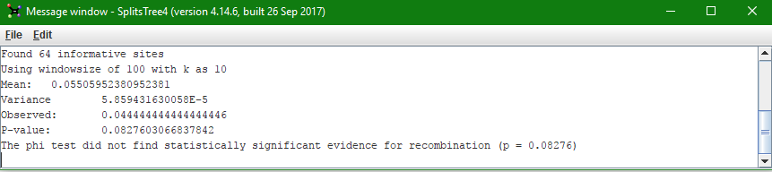

O teste Φ de recombinação é mais adequado para fragmentos pequenos e amostras populacionais, o que costuma ser o caso dos dados utilizados em delimitação de espécies. Entretanto, verificar seus dados através de métodos independentes fornece um teste robusto de hipóteses. Experimente rodar o teste Φ e, subsequentemente, utilizar o mesmo ‘window size’ estimado pelo SplitsTree nas configurações do DSS. No caso de divergência de resultados, atente-se para a eficiência dos métodos em cada caso e veja onde seus dados se ajustam. Enquanto o DSS funciona bem para fragmentos de grande extensão, o teste Φ funciona melhor nas condições citadas acima.

## 3. jModelTest

O jModelTest é um programa que permite testar o ajuste de modelos de evolução molecular aos dados.

Para realizar esta tarefa, você vai precisar de:

1. As sequências de cada um dos marcadores nucleares separadas, alinhadas e em formato FASTA.
2. O programa jModelTest.

**Passo-a-passo**

1. Abra o jModelTest e carregue o seu alinhamento.

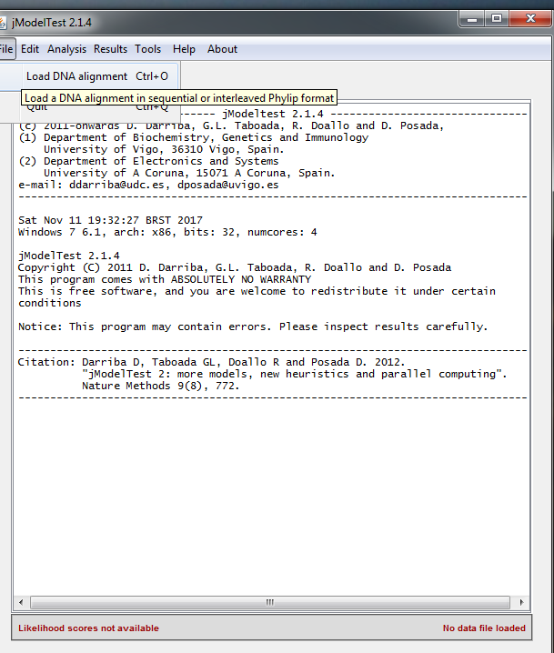

2. Em “Analysis” escolha “Compute likelihood score”.
3. Escolha apenas 3 esquemas de substituição (os modelos mais básicos implementados nos programas) e clique em “Compute likelihoods”.

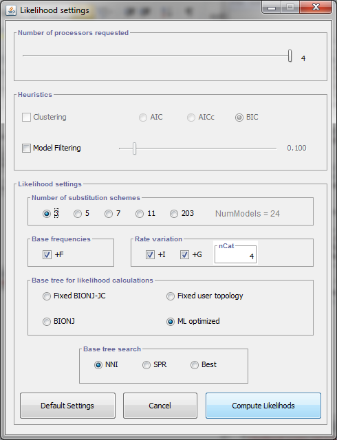

4. A saída te informa a verossimilhança de cada modelo em uma árvore estimada, o número de parâmetros (K) e os valores dos parâmetros que maximizam a verossimilhança.

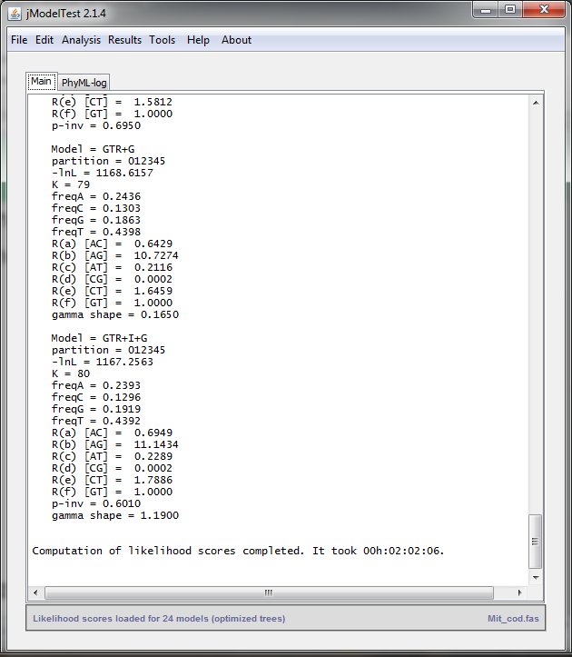

5. Em “Analysis” selecione “do AIC calculations”.
6. O resultado te mostra o modelo com melhor ajuste e os valores de AIC de todos os modelos.

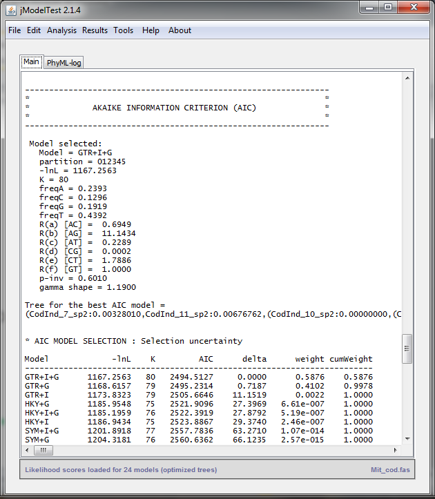

## 4. BEAST2

O BEAST 2 é um programa que permite utilizar uma gama de modelos para análises bayesianas filogenéticas e populacionais. Vamos utilizá-lo para estimar árvores de espécies utilizando o modelo coalescente, para testar o modelo de relógio molecular e para testar duas hipóteses de limite de espécies pré-determinadas, levando em conta a incerteza da topologia das genealogias, da filogenia e dos parâmetros do modelo.

Para realizar esta tarefa, você vai precisar de:

1. As sequências de cada um dos marcadores nucleares separadas, alinhadas e em formato FASTA. O nome da sequência deve ter um identificador padronizado da espécie, por exemplo:

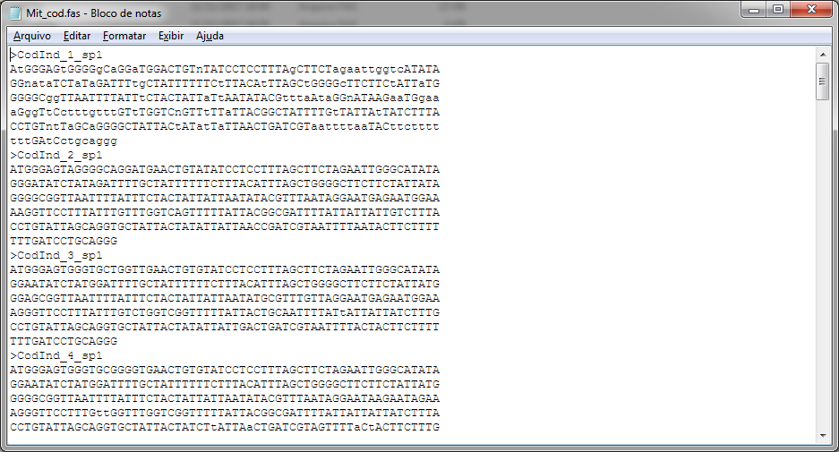

2. O pacote BEAST v. 2.7.x, incluindo o BEAUti, TreeAnnotator e DensiTree;
3. Os programas Tracer e FigTree devem ser baixados separadamente.

**Passo-a-passo**

1. Abra o BEAUti.exe, clique em ‘File > Manage Packages’ e instale os pacotes ***b*ModelTest** e **starbeast3**, selecionando-os e clicando em ‘Install/Upgrade’.

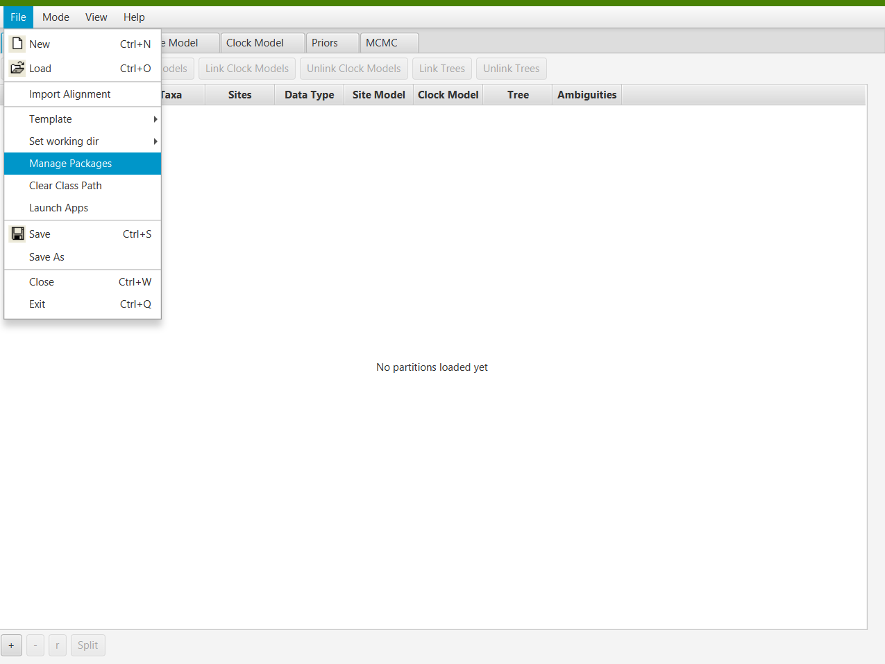

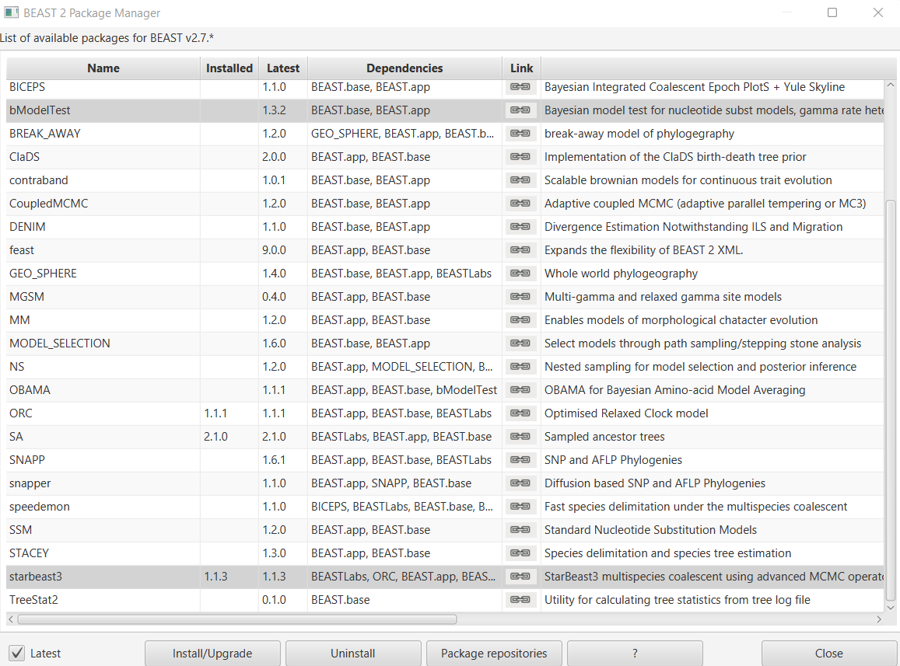

2. Finalizada a instalação, clique em ‘Close’ para fechar a janela do BEAST 2 Package Manager e retornar ao BEAUti.
3. Para habilitar o StarBEAST3, clique em ‘File > Template > StarBEAST3’. Observe que novas abas como ‘Taxon Sets’ e ‘Gene Ploidy’ estarão disponíveis neste template.

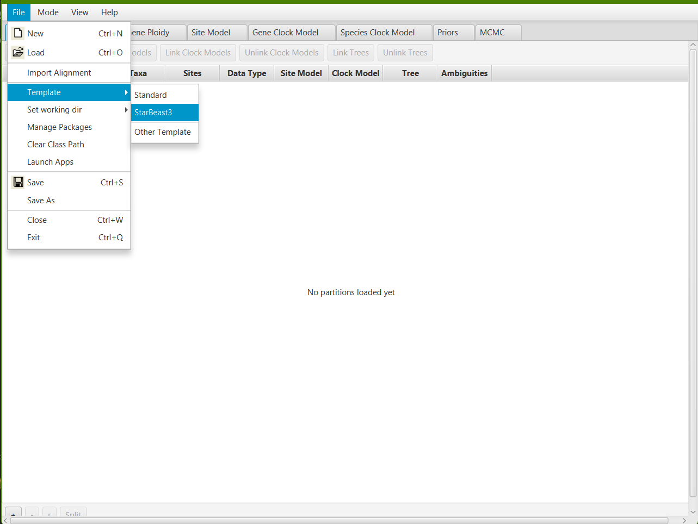

4. Importe os alinhamentos (ou simplesmente arraste os arquivos para a janela do BEAUti). Clicar no botão ‘+’ no canto inferior esquerdo da janela também funciona para abrir as sequências. Selecione ‘all nucleotide’ e clique em ‘OK’ para confirmar o tipo de dados no seu alinhamento. Repare que cada gene terá sua própria árvore, modelo de relógio e modelo de sítio. Você pode mudar isso, caso seja necessário. **Importante:** se você tiver dois ou mais fragmentos mitocondriais, você deve selecioná-los e clicar na opção ‘Link trees’, já que eles não são independentes.

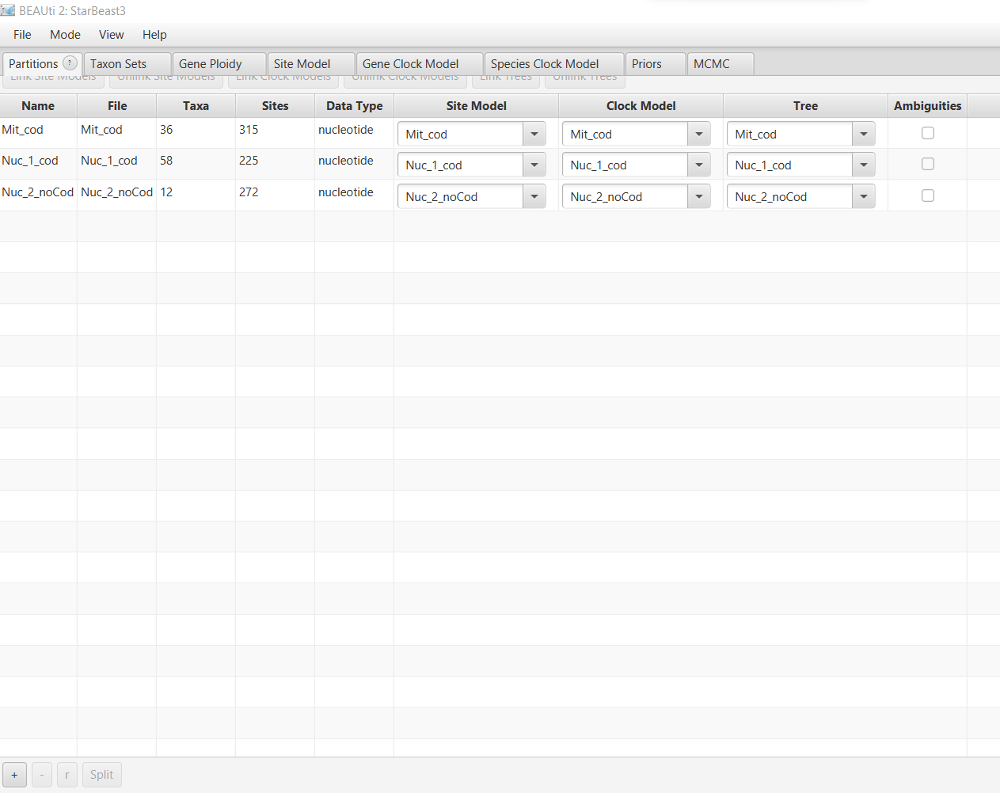

5. Na aba “Taxon Set” clique em “Guess” e depois selecione a forma de identificar onde está a informação que indica a qual espécie pertence cada sequência. No caso do exemplo, é a última palavra depois do último “_”.

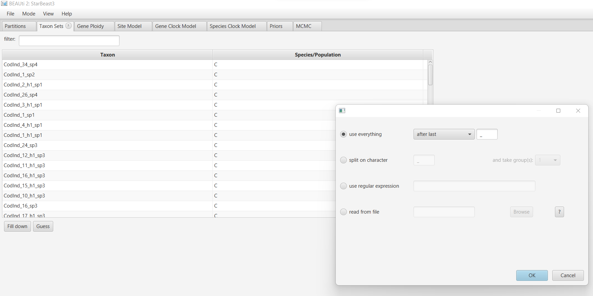

6. Na aba ‘Gene Ploidy’, configure os valores do gene mitocondrial como ¼ dos valores dos fragmentos nucleares. Por padrão, o valor de ‘ploidy’ é de 2.0 para os fragmentos nucleares. Logo, para o fragmento mitocondrial o valor deve ser configurado como 0.5.

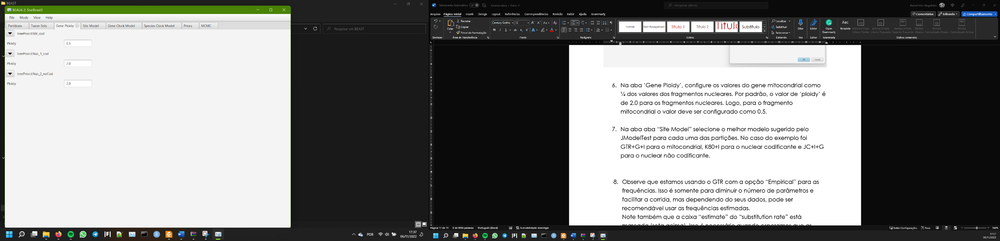

7. Na aba ‘Site Model’ selecione o ‘BEAST Model Test’ e a opção *allreversible* em ‘Model Set’. Faça isso para todos os fragmentos. Com isso, os modelos de substituição de melhor ajuste serão co-estimados junto com a árvore de espécies e a árvore gênica de cada fragmento amostrado.

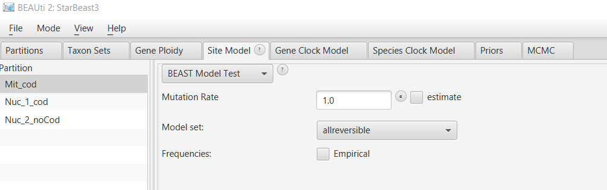

8. Na aba ‘Gene Clock Model’, marque todas as partições. Com isso, os relógios de todos os fragmentos serão estimados.

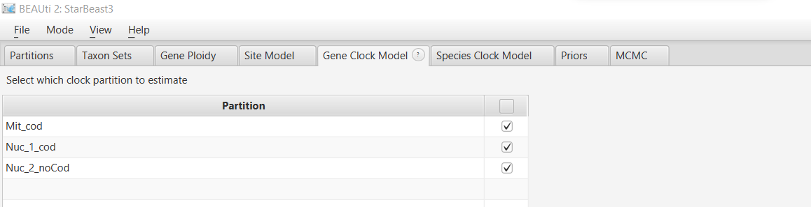

9. Na aba ‘Species Clock Model’ nós determinamos o modelo de relógio molecular. A princípio vamos considerar um modelo estrito ‘Species Tree Strict Clock’. Se você tem alguma informação da taxa de substituição (mutação por unidade de tempo), você deve configurá-la na aba ‘priors’ (ver adiante). Marque a caixa ‘estimate’ para que os comprimentos dos ramos da árvore de espécies sejam equivalentes aos tempos de divergência.

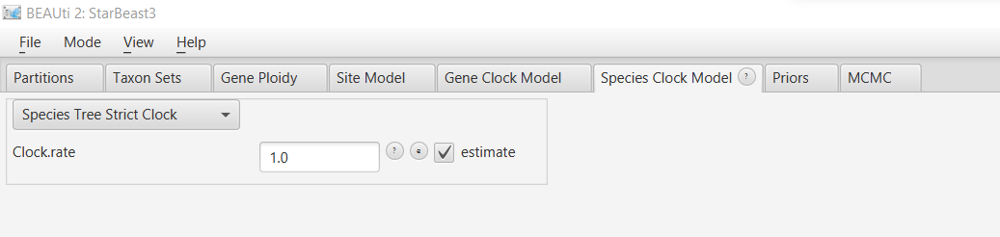

10. Caso tenhamos uma taxa de substituição de nucleotídeos conhecida para algum dos fragmentos, nós podemos utilizá-la para calibrar a nossa árvore de espécies. No nosso exemplo, colocaremos a taxa proposta para sequências mitocondriais de invertebrados (0.0115 substituições por linhagem por milhão de anos; Brower 1994). Para tanto, na aba “priors”, nós fixaremos este valor para o fragmento mitocondrial. Em *clockRate.c:Mit_cod* há duas janelas de opções. Na primeira, marcada como ‘Log Normal’ por padrão, temos a distribuição *a priori* do parâmetro. Na segunda, marcada como ‘initial = [1.0] [0.0, ∞]’, podemos clicar e fixar um valor para o parâmetro. Para tanto, substitua a caixa ‘value’ por 0.0115 e desmarque a opção ‘Estimate’. Para maiores detalhes sobre a configuração dos relógios moleculares, veja o sítio <https://beast2-dev.github.io/hmc/hmc//Priors/ClockPrior/>

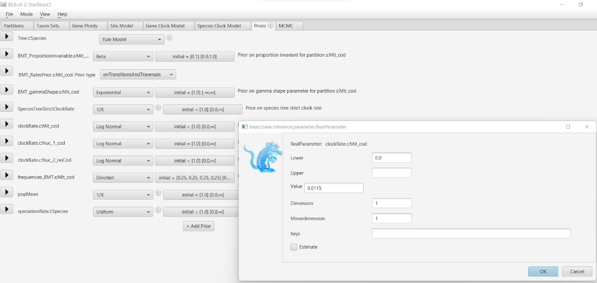

> [!NOTE]
> É importante saber a diferença do “substitution rate” da aba “site model” e do “clock rate” da aba “clock model”. A primeira é a taxa relativa entre cada partição, enquanto que a segunda é a taxa da partição em substituições por unidade de tempo. Para mais detalhes sobre como utilizar as duas, veja o sítio <https://www.beast2.org/2015/06/23/help-beast-acts-weird-or-how-to-set-up-rates/>.

11. Ainda no painel ‘priors’ modifique a distribuição dos parâmetros ‘SpeciesTreeStrictClockRate’ e ‘popMean’ de 1/X para ‘Log Normal’ e ‘Gamma’, respectivamente, já que a distribuição 1/X resulta em um prior impróprio quando os limites mínimo e máximo dos valores do parâmetro são desconhecidos (o que ocorre na maioria dos casos). Assume-se que o tamanho populacional dos ramos da árvore de espécie tem distribuição gamma, com um parâmetro de forma (“shape” k=2) e um parâmetro de escala ψ (opção “popMean”). É aqui que colocamos o prior da média da população. A média dessa distribuição é 2ψ. Ou seja, se sabemos que as populações atuais têm em média Ne=1000, e queremos colocar a média com esse valor, devemos colocar o parâmetro como 500. Entretanto, o padrão do programa é deixar um prior não informativo, então, esse seria apenas o valor inicial. Para mudar isso, temos que editar na aba “Priors”. No exemplo vamos deixar o padrão, mas utilize o que achar melhor para os seus dados.

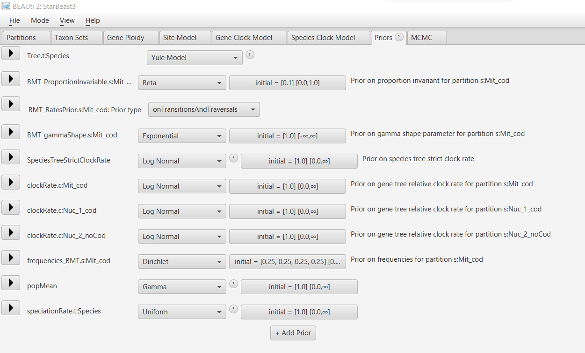

12. Ainda na aba “priors”, definimos a distribuição de probabilidade *a priori* de cada um dos parâmetros restantes. Vamos deixar o padrão, mas, caso tenha alguma informação forte acerca de um parâmetro para seus dados, você pode alterar aqui.
13. Por último, determinamos detalhes da busca da cadeia de Markov. No nosso exemplo, vamos correr 10000000 gerações, amostrando a cada 2000. Modifique os valores da caixa ‘Log Every’ para 2000 em todas as opções (i.e., tracelog, speciesTreeLogger e treelogs das árvores gênicas).

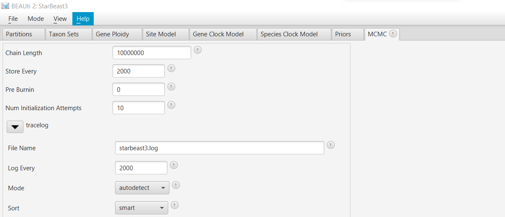

14. Salve seu arquivo, abra-o no programa BEAST.exe e inicie a análise.

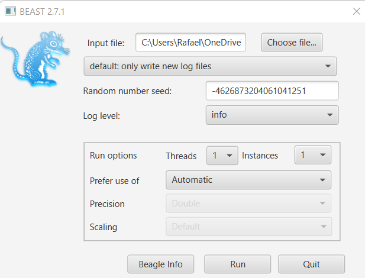

15. Ao terminar a corrida, o programa fornece algumas informações da MCMC. Caso sua busca não tenha sido boa e você precise correr mais gerações, você pode usar as sugestões de “tuning” para atingir a convergência mais rapidamente. Salve o arquivo como .txt para utilizar mais tarde, caso necessite. E consulte um dos professores para mais detalhes.

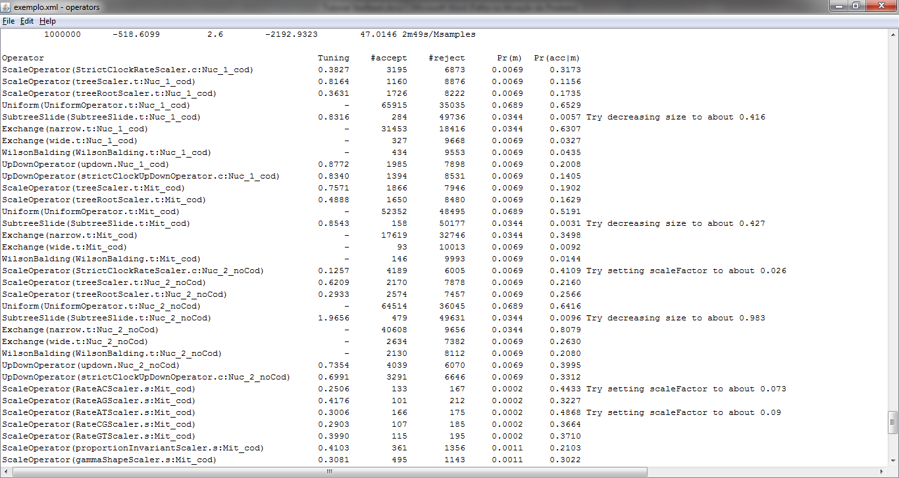

16. Abra o arquivo .log no Tracer. Verifique se o ESS está adequado (maior que 200, mas entre 100 e 200 é aceitável) e verifique se os parâmetros estabilizaram. Caso a corrida não tenha sido boa, rode novamente mudando os operadores e/ou aumentando o número de gerações (para mais informações, visite o sítio <https://www.beast2.org/increasing-esss/> e converse com os professores).

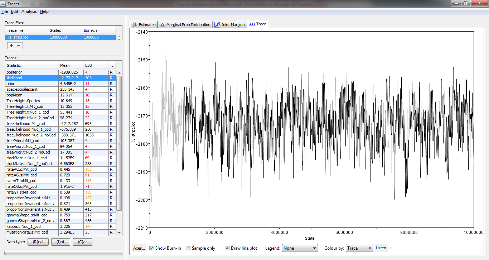

17. Para testar o relógio molecular, carregue no BEAUti.exe o arquivo .xml feito nos passos anteriores por meio do menu “File” e selecionando a opção “Load”. Na aba “Clock Model” selecione “Relaxed Clock Log Normal” para cada um dos marcadores. Lembre-se de mudar o nome dos arquivos de saída na aba MCMC.

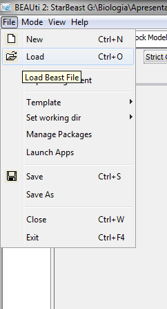

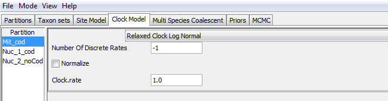

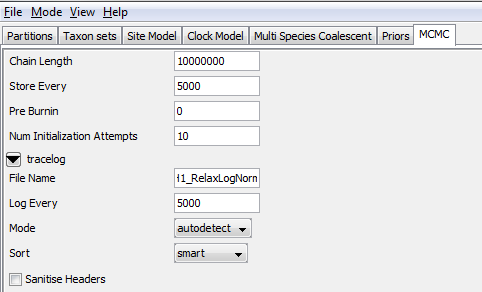

18. Salve o arquivo e repita os procedimentos dos passos 14 ao 16.
19. Caso a corrida esteja boa, abra os dois arquivos .log no Tracer, clicando no sinal de “+”. No nosso caso, temos os arquivos H1_strict.log e H1_relaxLogNorm.log.
20. Como falado nas aulas, há várias formas de comparar hipóteses (modelos). Primeiro vamos mostrar por meio do AICM calculado com a distribuição posterior da verossimilhança. Para isso, no Tracer, no menu “Analysis”, selecione “Model comparison”.

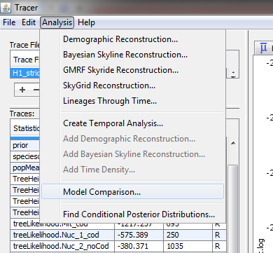

21. No menu seguinte, selecione o trace likelihood, o tipo de análise (AICM) e o número de replicações de bootstrap.

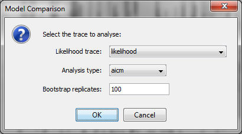

22. O resultado mostra o AICM de cada hipótese. A que tem menor AICM é a que os dados se ajustam melhor. No nosso caso o modelo de relógio estrito é melhor.

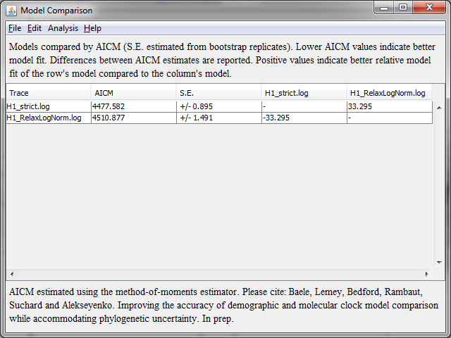

23. Vamos agora testar as hipóteses de limite entre as espécies. Já temos o resultado da corrida considerando as 4 espécies como espécies distintas. Agora vamos testar a hipótese de que as espécies sp3 e sp4 não são linhagens evolutivas distintas. Para isso, no BEAUti, carregue o arquivo xml do melhor relógio molecular testado no passo anterior. Na aba “Taxon sets”, use o filtro para achar todos os indivíduos que pertencem à espécie sp4. Em seguida, indique na coluna “Species/Population” que esses indivíduos pertencem a sp3. Você pode mudar só na primeira, selecionar todas e depois clicar no botão “fill down”. Mude o nome dos arquivos de saída na aba MCMC e salve.

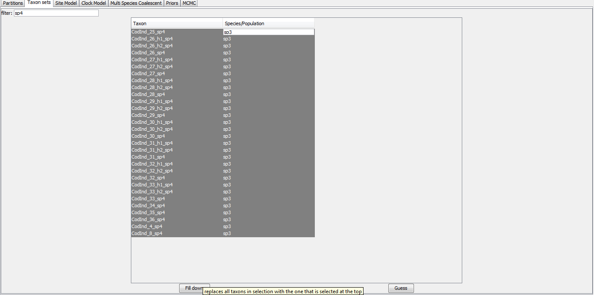

24. No BEAST.exe, corra essa análise do arquivo que acabou de salvar. Em seguida, abra o arquivo .log no Tracer para verificar se a corrida foi boa.
25. Para testar as duas hipóteses de delimitação, você pode utilizar o AICM, como fizemos nos passos 20, 21 e 22. Uma maneira melhor seria calcular a verossimilhança marginal do modelo através de “path sampling” e calcular o fator bayesiano entre as duas hipóteses. Para isso, abra o arquivo AppStore.exe do pacote do BEAST e selecione o app “PathSampling”.

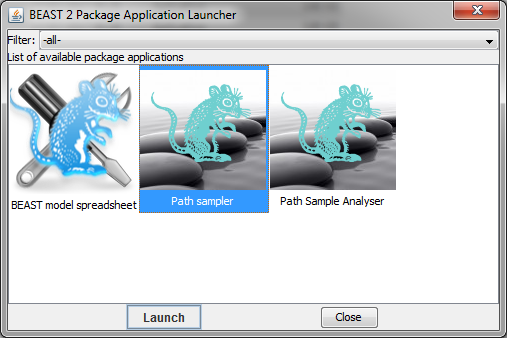

26. Selecione o arquivo xml correspondente a uma das hipóteses e os parâmetros da corrida.

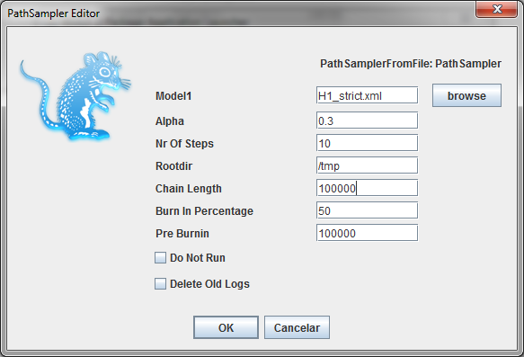

27. No final da corrida, será dado o valor do Log da verossimilhança do modelo. Faça o mesmo para a outra hipótese de delimitação e calcule o LogBayesFactor = LogL H0 – LogL H1. Valores positivos favorecem a hipótese 0, enquanto que valores negativos favorecem a hipótese 1. Você também pode utilizar a tabela abaixo.

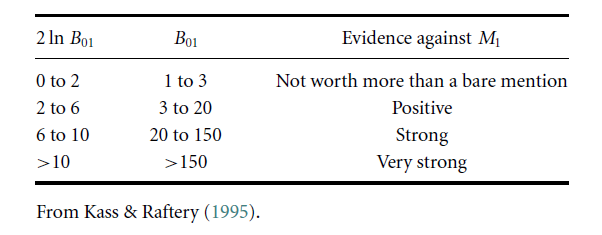

Você pode ver mais detalhes de como fazer o “Path Sampling” editando o xml neste link: <https://www.beast2.org/path-sampling/>

28. Para visualizar as genealogias e filogenias, sumarizamos as árvores de maior probabilidade posterior utilizando o TreeAnnotator. Abra o TreeAnnotator.exe, selecione a porcentagem de “burnin”, as opções de árvores e de altura dos nós, o arquivo de entrada e o de saída. Para a filogenia, selecione o arquivo “...species.trees”. As genealogias terão o nome do arquivo de alinhamento de cada marcador (se você não mudou isso no BEAUti).

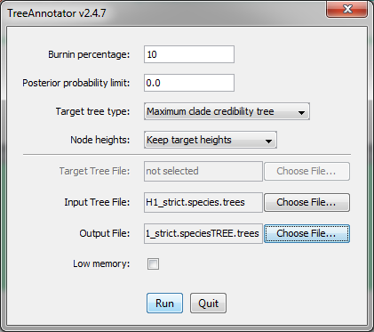

29. Você pode visualizar cada árvore separadamente no programa FigTree. Se você tiver os mesmos táxons amostrados para os genes, pode editar um arquivo nexus com a melhor árvore de cada gene para ver a incongruência entre genealogias com o DensiTree (figura abaixo).

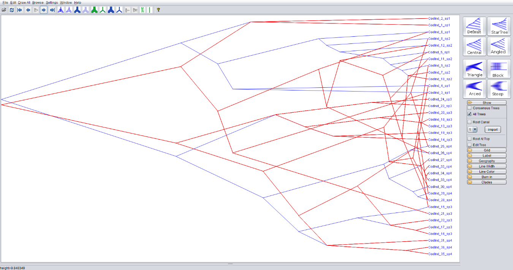

## 5. Visualizando genealogias dentro de filogenias com Mesquite

Para realizar esta tarefa, você vai precisar de:

1. Programa Mesquite;
2. As árvores de espécies e genealogias em um arquivo nexus.

**Passo-a-passo**

1. Abra a árvore de genes no programa Mesquite (clique com o botão direito e selecione “abrir com”, caso o Mesquite não seja o padrão).
2. Abra a árvore de espécies por meio do menu “Taxa&Trees”, em seguida “Import files with trees”, “Include contents...”.

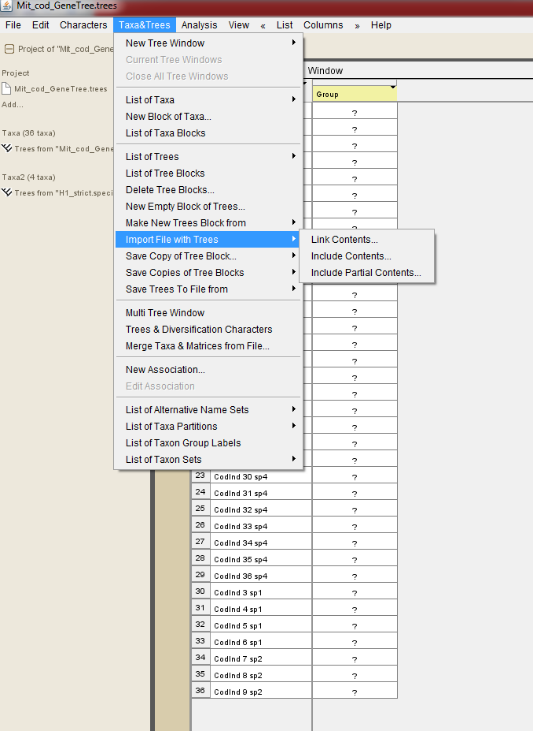

3. Faça a associação entre espécies e indivíduos. No menu “Taxa&Trees” selecione “New Association” e em seguida selecione o bloco de Taxa que corresponde à árvore de espécies (no nosso caso Taxa2).

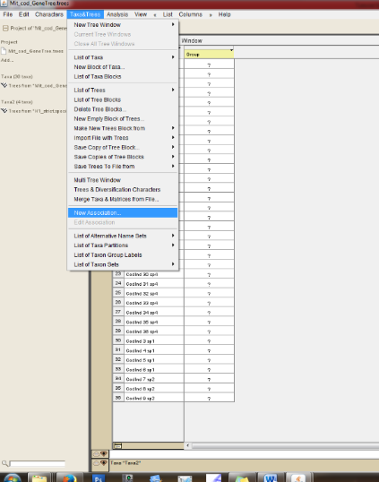 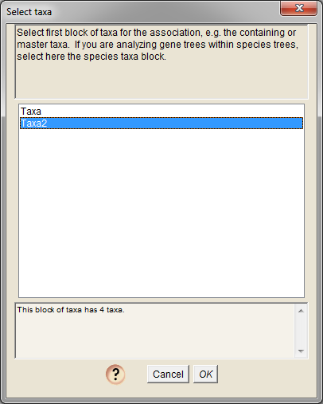

4. Selecione a espécie e, na coluna da direita, selecione os indivíduos que pertencem àquela espécie clicando no “+”.

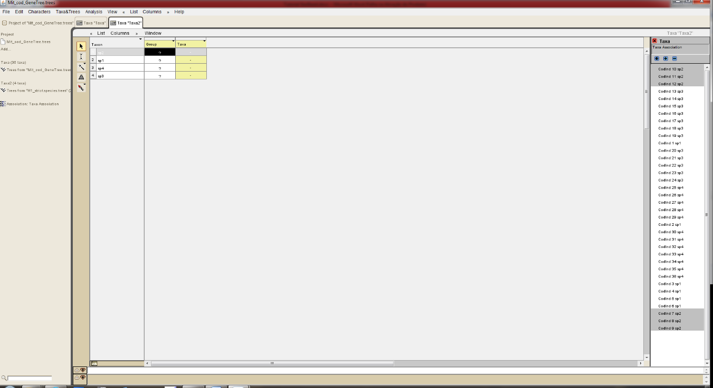

5. Abra uma aba com uma das árvores clicando na árvore no menu da coluna da esquerda e, em seguida, clicando em “View Tree”.

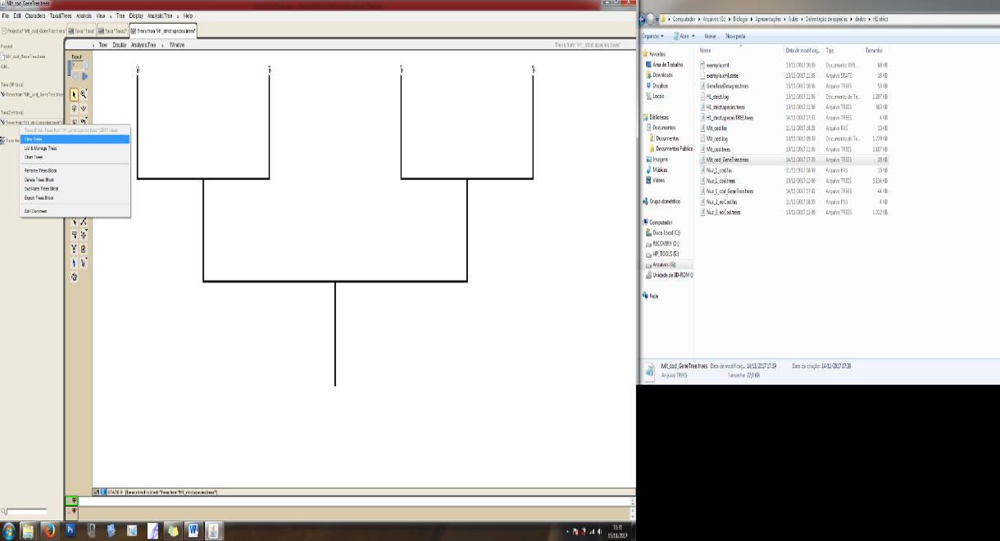

6. No menu “Display” selecione “Tree form” e em seguida “Contained Gene (or Other) Trees”.

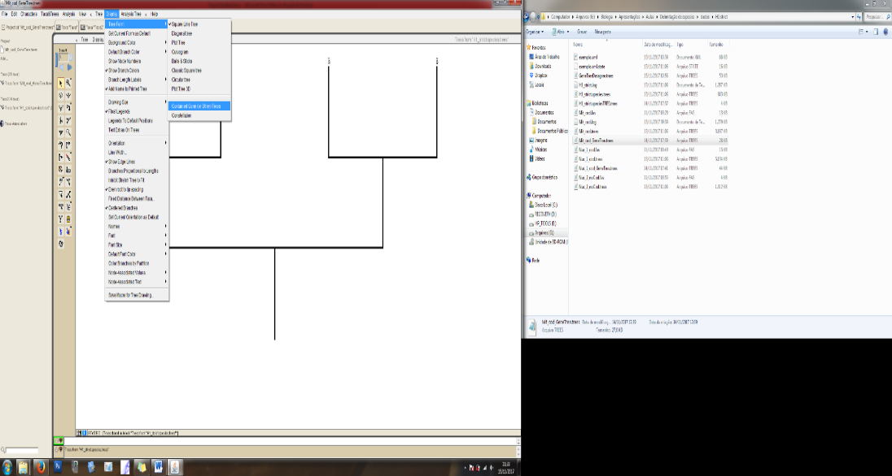 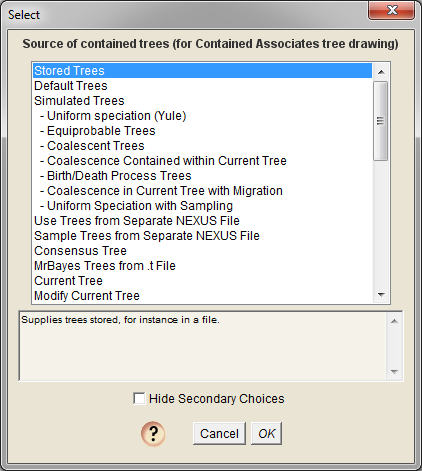

7. Para visualizar melhor, desmarque a opção “Use branch lengths of contained”.

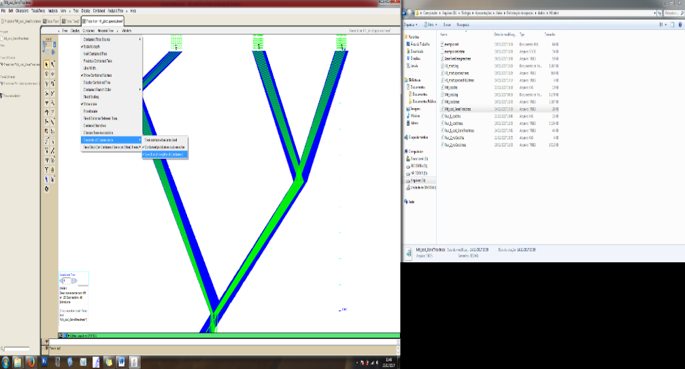

8. A partir daí você pode editar a árvore utilizando as ferramentas e menus dessa aba. Quando estiver pronta, pode exportar como PDF através do menu “File”.

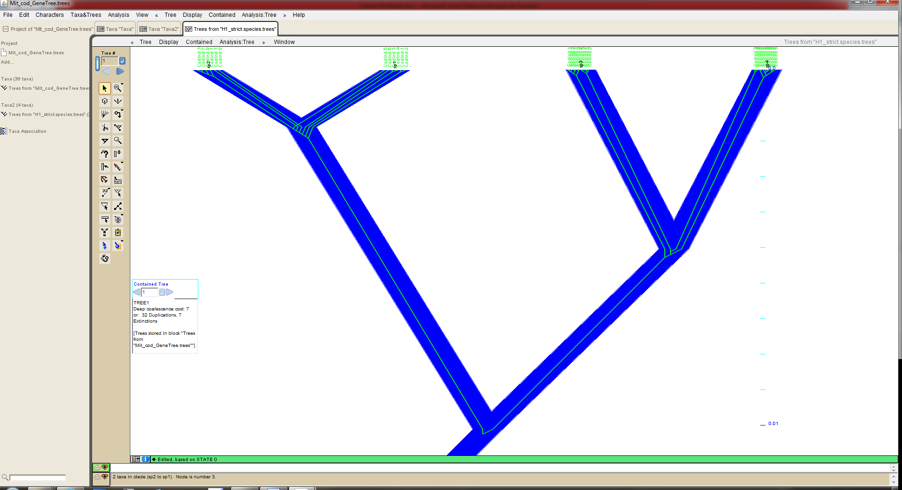

## 6. Haplowebs

Haplowebs é um método gráfico proposto por Flot e colaboradores (2010) para delimitação de espécies. O modelo é bastante simples e parte da seguinte premissa: conjuntos de alelos exclusivos, que englobam indivíduos em múltiplos marcadores independentes, são considerados espécies candidatas. Estes grupos são delineados através da co-ocorrência de alelos na fase diploide. Cada grupo de indivíduos é denominado *field for recombination*.

Para esta prática, você vai precisar de:

1. Os fragmentos nucleares faseados e alinhados;
2. Acesso à internet para o uso da plataforma web HaplowebMaker;
3. Um editor de imagens ou as redes de haplótipos impressas para cada um dos fragmentos.

**Passo-a-passo**

1. Para realizar esta atividade, você precisará de um arquivo para cada fragmento, contendo suas sequências faseadas e alinhadas, em formato FASTA. Todas as sequências, em cada arquivo, precisam ter o mesmo comprimento, não ter nucleotídeos ambíguos nem caracteres especiais.
2. Abra o [link](https://eeg-ebe.github.io/HaplowebMaker/) do HaplowebMaker e dê um nome para o seu projeto.

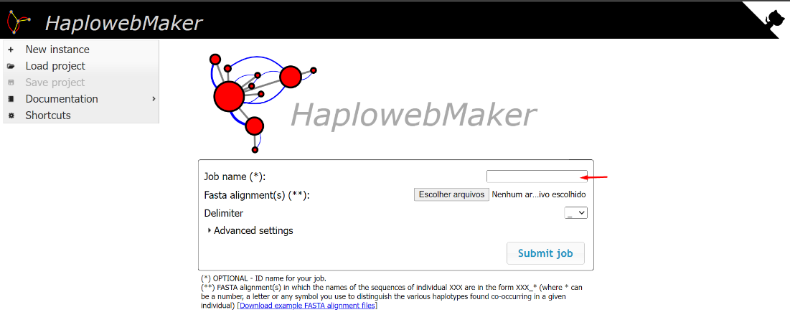

3. Clique em “Escolher arquivos” e carregue seus alinhamentos. Ao abrir a janela de arquivos, selecione todos os fragmentos que deseja avaliar ao mesmo tempo. Não esqueça de escolher o delimitador individual das suas sequências.

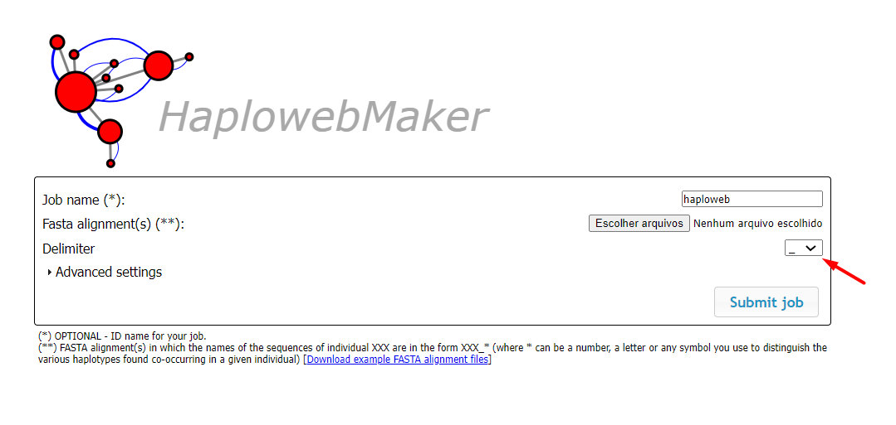

4. Clique em Advanced settings e escolha as configurações da sua análise. Escolha como os *indels* devem ser tratados (*missing* ou 5° estado), como o programa deve tratar casos de caracteres ambíguos (erro ou mascarar), o algoritmo que deseja para gerar a rede de haplótipos (*median joining* ou *minimum spanning network*) e o que representará a área e espessura do círculo. Para esta prática, vamos deixar todas as opções no padrão. Em seguida, clique em *Submit Job*.


5. O programa irá abrir uma nova página, contendo a barra de progresso da análise e uma caixa de visão geral para cada fragmento submetido. Nestas caixas vemos um resumo de várias estatísticas, incluindo o número de posições variáveis, número de haplótipos (e de vetores medianos, se aplicável) e número de campos para recombinação (*fields for recombination* — FFRs). Em geral o progresso é rápido; se ele não sair de algum valor por um tempo, verifique se ele leu todos os arquivos corretamente (no quadro geral de cada fragmento), sem erros ou interrogações.


6. Logo abaixo encontramos nossos resultados. A primeira coluna em *Actions* nos permite ver o resultado em uma nova guia no navegador e a segunda nos dá a opção de fazer o download do resultado.


7. Entre os resultados encontramos as redes de haplótipos de cada fragmento, com os campos de recombinação. Clique em ‘View’ no item ‘alfa.fasta.svg’ para analisarmos.


8. Ele abrirá uma nova guia com o resultado.


9. Para editar sua rede clique em ‘edit’.


10. Nesta janela podemos mudar algumas características da rede de haplótipos. Explore o programa para escolher as cores e o tamanho da rede. Quando ela estiver configurada do seu gosto, clique em ‘Save’.


11. A versão automatizada de construção das haplowebs nos permite uma análise combinada de todos os dados. Clique em ‘View’ em ‘CoMa’, para visualizar a matriz de co-especificidade (*Conspecificity Matrices*).


12. Esta ação transforma a matriz de partição em uma matriz de co-especificidade e a ordena, produzindo uma figura na qual cada espécie é revelada como um quadrado ao longo da diagonal.


13. Você pode salvar seu projeto completo, ou cada imagem e matriz independentemente.


## 7. Structure

O Structure é um método probabilístico de agrupamento de indivíduos baseado em modelo. A ideia por trás do algoritmo é a busca de um número de populações (K) que minimizem o desequilíbrio de Hardy-Weinberg globalmente. Uma premissa importante do modelo é que os fragmentos utilizados estejam em equilíbrio de ligação (i.e., eles evoluem de forma *quasi*-independente). No exercício abaixo realizaremos uma análise com marcadores diploides (microssatélites, SNPs, sequências nucleares, ...). Contudo, você também pode realizar uma análise utilizando apenas marcadores plastidiais, com algumas poucas modificações (ver manual do programa).

Para realizar esta tarefa, você vai precisar de:

1. Software Structure instalado;
2. Aplicativos CLUMPP e DISTRUCT baixados;
3. Acesso à internet para o uso da ferramenta on-line Structure Harvester;
4. Ao menos dois marcadores diploides independentes.

**Passo-a-passo**

1. Vamos montar o input para as análises. Aqui os seus caracteres são os haplótipos de cada uma das sequências. Mesmo que você possua múltiplos sítios segregantes em cada sequência, você não pode utilizá-los como caracteres independentes, pois eles estão todos em desequilíbrio de ligação dentro de cada marcador. Logo, utilize o DnaSP para listar todos os seus haplótipos. O input consiste nos seguintes elementos: (1) a primeira linha contém o nome dos marcadores, (2) as próximas linhas contêm as informações sobre cada indivíduo, sendo que cada duas linhas consecutivas correspondem a um indivíduo (**os nomes devem ser iguais para cada indivíduo**). (3) A primeira coluna contém o nome dos indivíduos, (4) a segunda coluna pode conter informações prévias (p.ex., localidade de coleta ou populações identificadas por cada método) e (5) cada uma das próximas colunas contém informações sobre os marcadores. Neste caso, a cada duas colunas nós temos os dois alelos de cada marcador. Dados faltantes são representados por ‘-9’. Note que as colunas são separadas por espaços. Inclua o número de cada haplótipo nas linhas dos marcadores.


> [!TIP]
> **Bonus!** Todo este processo pode ser automatizado. Basta você ter um arquivo NEXUS com as sequências nucleares concatenadas e blocos de partições identificando os limites dos caracteres (*charsets*) e, no caso da presença de informações *a priori*, partições com *taxset*. Por exemplo:
>
> ```
> begin sets;
> charset marcador1 = 1-561;
> charset marcador2 = 562-1226;
> taxset population1 = PHY331_ayeaye_typeloc PHY89_ayeaye_SaoRoque …;
> taxset population2 = PHY402_oreades_Brasilandia PHY360_oreades_Minaçu …;
> end;
> ```
>
> Tendo este arquivo, a conversão para o input do Structure é feita automaticamente com o auxílio do programa PGDSpider2.

2. Abra o Structure, clique em “File > Open Data File...” e carregue o input.
3. Clique em “File > New Project...”. Na janela que se abrirá, dê o nome para o projeto, escolha uma pasta onde os outputs serão salvos e selecione o seu input. Clique em “Next>>”.


4. Na próxima janela, informe o número de indivíduos, o número de loci, a ploidia dos dados (2 para marcadores nucleares em organismos diploides) e o código de dados faltantes usado (no caso do exemplo, o código foi -9). Clique em “Next>>”.


5. Na próxima janela, marque a opção “Row of marker names” e clique em “Next>>”.
6. Por fim, marque as informações presentes nas colunas do seu input. No exemplo utilizado para a elaboração deste tutorial, temos uma coluna com o nome dos indivíduos e uma com a população putativa de origem de cada um deles. Por este motivo, marcamos as opções “Individual ID for each individual” e “Putative population origin for each individual”. Clique em “Finish”. Confira se as informações estão corretas e clique em “Proceed”.


7. Agora que seu projeto foi criado, podemos prosseguir com a análise. Clique em “Parameter Set > New...”. Uma janela com quatro abas será aberta. Na primeira aba (Run Length) será configurada a amostragem nas cadeias de Markov. Para esta prática, use um burnin de 50000 e um número de réplicas de 100000.


8. Na próxima aba (Ancestry Model) selecione “Use Admixture Model” para estimar a probabilidade de cada indivíduo pertencer a cada um dos clusters.
9. Na aba “Allele frequency model”, selecione “Allele Frequencies Correlated”. Escolha este modelo, pois ele é mais apropriado para a delimitação de estrutura genética pouco refinada (que é o caso de linhagens especiadas).
10. Na última aba (Advanced), selecione a opção “Compute probability of the data (for estimating K)” e clique em “OK”. Dê um nome para a sua configuração de parâmetros e clique em “OK”.


11. Clique em “Project > Start a Job”. Selecione o seu projeto e configure um alcance mínimo e máximo de valores de K. É recomendável que o menor valor de K seja configurado em 1 e o maior tenha alguma correlação com a biologia do organismo em questão. Por exemplo, se você trabalha com uma espécie que ocorre em diferentes bacias hidrográficas e possui evidências de que as bacias limitam a distribuição geográfica das mesmas, o ideal é configurar o valor máximo de K como o número de bacias + 1. Por fim, configure o número de réplicas da análise em “Number of iterations:”. Para esta prática usaremos três réplicas. Clique em “Start”.


12. Quando a análise for finalizada, clique em “OK”.
13. Vá para a pasta onde os outputs foram salvos e busque a pasta “Results”. Compacte esta pasta em um arquivo .zip.
14. Abra o site do Structure Harvester e carregue seu arquivo .zip. Clique em “Harvest!”. O Harvester irá resumir todas as suas réplicas em um único arquivo. Além disso, o melhor valor de K será indicado através da estatística ΔK.


15. Salve os gráficos, tabelas e os arquivos “Clumpp indfile” e “Clumpp popfile” referentes ao melhor valor de K obtido (marcado em amarelo na tabela de Evanno).


16. Copie o “Clumpp indfile” para a pasta do CLUMPP.exe. Abra esta pasta e clique duas vezes no executável. Consulte os professores sobre as configurações no arquivo de parâmetros do CLUMPP.


17. Após o término da análise no CLUMPP, será gerado um arquivo .outfile. Copie e cole na pasta do DISTRUCT. Modifique a extensão do arquivo para .indivq, que contém as probabilidades de atribuição de cada indivíduo a cada população delimitada. Você também necessitará de um arquivo .names (que contém a identificação de cada indivíduo, na mesma ordem do .indivq), um arquivo .locs (que contém informações sobre a localização geográfica ou a população de cada amostra) e um arquivo .perm (que indica a cor de cada população; ver a lista no manual). Na pasta do DISTRUCT, há um arquivo chamado “drawparams”. Nele você deve configurar a sua análise, indicando cada um dos inputs (clique [aqui](https://1drv.ms/u/s!AkKRKMNNRivYi_BMkIZc2ff-pQvS0g) para baixar um modelo). Copie os inputs e o “drawparams” na pasta do DISTRUCT e clique no arquivo executável. Um output .ps será gerado.
18. Entre no site <https://online2pdf.com/en/ps2pdf>, carregue o output do DISTRUCT e clique em “Convert”. Será gerado um arquivo .pdf com o Q-plot, que poderá ser melhorado em qualquer programa de edição de imagens vetorizadas como o Adobe Illustrator, o Corel Draw ou o Inkscape.


## 8. ML-GMYC

O *Generalized Mixed Yule Coalescent* (GMYC) é um modelo que combina eventos estocásticos de aumento do número de linhagens específicas (modelo Yule) com a teoria coalescente, sendo capaz de determinar o ponto de transição entre os processos que ocorrem no nível específico (i.e., especiação) e os processos que ocorrem a nível populacional. O GMYC foi desenvolvido para a descoberta de espécies putativas em árvores gênicas, sobretudo de marcadores mitocondriais. Nesta tarefa, vamos realizar a implementação de máxima verossimilhança do modelo, que realiza um teste da razão de verossimilhanças entre a hipótese nula (i.e., apenas uma espécie) e as hipóteses alternativas (i.e., mais de uma espécie). Para tanto, serão necessários:

1. A última versão do programa R instalada;
2. O aplicativo RStudio;
3. O pacote *splits* instalado no R e suas dependências (*ape*, *MASS* e *paran*);
4. Uma árvore gênica ultramétrica dos haplótipos únicos de um marcador mitocondrial.

**Passo-a-passo**

1. Instale o pacote *splits* e suas dependências com os comandos:

```r
install.packages("splits", repos="http://R-Forge.R-project.org")
install.packages("ape", dependencies=T)
```

2. Primeiramente gere a árvore gênica de haplótipos únicos. Para tanto, você vai precisar de um arquivo NEXUS contendo estes haplótipos. Depois disso, converta este arquivo em FASTA com o auxílio do programa AliView ou PGDSpider. Por fim, selecione o modelo evolutivo que melhor se ajusta ao seu conjunto de haplótipos únicos (Tutorial 3).
3. Para gerar a árvore gênica, siga o Tutorial 4, passos 1–16, ignorando o template StarBEAST3 (passo 3) e as abas específicas dele (passos 5 e 6). Se você não possui nenhuma taxa para a calibração de sua árvore gênica, não se preocupe, basta manter a taxa em 1 (by default). Após terminar a análise, anote a melhor árvore (Tutorial 4, passo 28).
4. Abra sua árvore no FigTree e exporte-a no formato Newick. Para tanto clique em “File > Export Trees” e na janela que se abrirá, selecione Newick em “Tree file format” e desmarque todas as opções. Certifique-se de que você possui uma única árvore carregada.


5. Abra o RStudio e mude o diretório para a pasta onde se encontra o arquivo de árvore. Para tanto clique em “Session > Set Working Directory > Choose Directory…”.


6. Carregue o pacote *splits* através do comando `library(splits)` na janela console.
7. Abra sua árvore, criando um objeto, através do comando `read.tree("nomedoarquivo.nwk")->objeto1`. Confira se sua árvore é ultramétrica através do comando `is.ultrametric(objeto1)`.
8. Se você possui grupos externos na sua árvore, você deve removê-los através do comando `c("outgroup1",...,"outgroupn")->objeto2` seguido do comando `drop.tip(objeto1,objeto2)->objeto3`.
9. Realize a análise através do comando `gmyc(objeto3)->results_GMYC`. Por definição, o pacote realiza o método de “single threshold”. Para visualizar o resultado da análise, utilize o comando `summary(results_GMYC)`.


Neste exemplo, o método identificou três espécies candidatas, com um intervalo de 2–13, e a hipótese nula foi rejeitada (LR = 9,513; p = 0,009).

10. Para visualizar as figuras resultantes da análise, incluindo o threshold entre os processos Yule e coalescentes e a árvore com as espécies putativas destacadas, utilize o comando `plot(results_GMYC)`.


11. Por fim, você pode visualizar qual haplótipo pertence a cada espécie candidata através do comando `spec.list(results_GMYC)`.

## 9. *b*GMYC

Note que para a realização do ML-GMYC, apenas uma árvore foi utilizada, no caso do Tutorial 8, a árvore gênica com clados de máxima credibilidade (MCC) obtida através do BEAST2. Entretanto, a MCC é uma dentre **n** árvores amostradas. Consequentemente, a incerteza filogenética associada à MCC não é computada no ML-GMYC. Pensando nisso, Reid e Carstens (2012) desenvolveram uma extensão bayesiana do método GMYC. Basicamente, o *b*GMYC realiza múltiplas rodadas de GMYC, cada uma delas com uma árvore distinta dentre aquelas amostradas na cadeia de Markov. As probabilidades de cada espécie putativa são apresentadas em função da proporção de vezes em que aquela espécie foi recuperada em diferentes árvores. Para realizar esta análise, você vai precisar de:

1. A última versão do programa R instalada;
2. O aplicativo RStudio;
3. Os pacotes *bGMYC*, *ape* e *TreeTools*;
4. A árvore gênica do exercício anterior e o arquivo .trees (com todas as árvores amostradas) gerado pelo BEAST2.

**Passo-a-passo**

1. Cole sua árvore .nwk e o arquivo .trees em uma mesma pasta. Mude o diretório de trabalho do R para este endereço.
2. Carregue os pacotes *ape*, *TreeTools* e *bGMYC* utilizando o comando `library`.
3. Carregue sua árvore .nwk e crie um objeto através do comando `read.tree("arvore.nwk")->tr`.
4. Carregue todas as árvores amostradas pelo BEAST2 e crie outro objeto através do comando `read.nexus("arvores.trees")->trs`.
5. Defina seus outgroups com o comando `c("outgroup1",...,"outgroupn")->out`.
6. Agora, faremos uma subamostragem aleatória das árvores no arquivo “arvores.trees”. Para tanto, digite `sample(trs,250)->trs2` para amostrar 250 árvores e criar um novo objeto. Aqui, você também precisa excluir os outgroups. Para isso, use o comando `lapply(trs2,drop.tip,out)->trs3`.
7. Ademais, você precisa definir este novo objeto como um conjunto de dados da classe multiPhylo. Para isso, use o comando `as.multiPhylo(trs3)`. Para conferir se a transformação foi feita e se as árvores do arquivo são todas ultramétricas, digite o comando `is.ultrametric.multiPhylo(trs3)`.
8. Para rodar o *b*GMYC usando múltiplas árvores, utilize o comando abaixo. Para entender o que são os parâmetros da análise, clique [aqui](https://sites.google.com/site/noahmreid/software/bGMYC_instructions_14.03.12.txt?attredirects=0&d=1).

```r
bgmyc.multiphylo(trs3, mcmc=10000, burnin=2500, thinning=10, py2=1.2, t1=1, t2=13,
                 start=c(1,0.5,5), scale=c(1,40,0.5))->splb
```

9. Verifique a convergência da análise através do comando `plot(splb)`. Serão geradas várias figuras para a verificação gráfica.


10. Para visualizar a distribuição das probabilidades posteriores de cada espécie no contexto de uma árvore, digite o comando `spec.probmat(splb)->result.probmat` seguido do comando `plot(result.probmat,tr)`.


11. Caso queira visualizar esta figura como uma tabela com as probabilidades par-a-par, digite o comando `write.csv(result.probmat,file="probs.csv")`. O arquivo “probs.csv”, que estará salvo na sua pasta de trabalho, poderá ser aberto em qualquer editor de textos e tabelas. Com estes dados, você pode representar as probabilidades através de números nos nós da árvore.

## 10. *b*PTP (web server)

O *Poisson Tree Process* (PTP) é um método de descoberta que modela os eventos coalescentes e de especiação relativamente ao número de substituições na árvore, usando algoritmos heurísticos para classificar os ramos como resultantes de processos populacionais ou de especiação. O PTP foi desenvolvido para a descoberta de espécies putativas em árvores gênicas, sobretudo de marcadores mitocondriais. Nesta tarefa, vamos utilizar a versão bayesiana do modelo, que calcula a incerteza associada a cada espécie candidata delimitada. Para realizar esta análise, você precisará de:

1. Uma árvore não-ultramétrica;
2. Acesso ao servidor web do *b*PTP através de um navegador de internet.

**Passo-a-passo**

1. Abra o site <https://species.h-its.org/> no seu navegador de internet;
2. Na opção ‘My phylogenetic input tree’, clique em ‘Procurar’ e abra o seu arquivo com a árvore filogenética;


3. Se a sua árvore for enraizada em um grupo externo (como é o caso do nosso exemplo), selecione a opção ‘Rooted’ em ‘My tree is:’, digite o nome do(s) grupo(s) externo(s) na janela ‘Outgroup taxa names (if any):’ (**Hap1_Pdistincta_SaoBentodoSul_SC** no nosso arquivo de exemplo) e clique na opção “Remove outgroups...”;


4. Por fim, digite seu endereço de e-mail na opção “My e-mail address:” e clique em submit;
5. Anote seu ‘**job id**’. Você conseguirá acessar a sua análise com este número e seu endereço de e-mail através da aba ‘Look up jobs’.


## 11. *m*PTP

Apesar de ser um modelo de delimitação bastante robusto, o PTP assume que as substituições são constantes ao longo da árvore ou que os eventos coalescentes e de especiação ocorrem a uma taxa constante por eventos de substituição. Para contornar este pressuposto, o modelo *multi-rate Poisson Tree Process* (*m*PTP) considera a variação na taxa de divergência dentro das espécies candidatas presentes na árvore. Para esta análise você precisará de:

1. Uma árvore não-ultramétrica;
2. Acesso ao servidor web do *m*PTP através de um navegador de internet.

**Passo-a-passo**

1. Acesse o site <https://mptp.h-its.org/#/tree> no seu navegador da internet;
2. Na janela ‘Newick file upload’, clique em ‘Drop newick file or click to upload’ e carregue a sua árvore. Após carregada, clique em ‘Proceed to outgroup selection’ no canto inferior direito da página;


3. Na janela ‘Outgroup specification’, selecione todos os seus grupos externos, caso a sua árvore esteja enraizada. No nosso exemplo, o outgroup é o indivíduo “**Hap1_Pdistincta_SaoBentodoSul_SC**”. Marque a opção ‘Crop outgroup’ e clique em ‘Model Selection’ no canto inferior direito;


4. Na janela ‘Model selection’ marque a opção ‘Use MPTP’ e clique no botão ‘Visualization options’ no canto inferior direito;
5. Na janela ‘Visualization options’, clique em ‘Auto-detect’ e depois em ‘Contact details’ no canto inferior direito;
6. Por fim, preencha seu e-mail na janela ‘Contact details’ e clique em ‘Overview’ no canto inferior direito;
7. Na janela ‘Overview’ você irá visualizar todos os dados sobre o seu job, incluindo o nome do input, o número de ramos terminais, o modelo de delimitação e o grupo externo (quando houver). Em ‘command-line execution’ você terá acesso à linha de comando com as configurações da análise, caso queira rodá-la em seu próprio computador. Clique em ‘Submit’;


8. Os resultados incluem um arquivo \*.svg que contém uma árvore filogenética com os ramos intrapopulacionais representados em vermelho e os ramos interespecíficos representados em verde. Além disso, há também um arquivo \*.txt listando quais sequências pertencem a cada espécie.

## 12. Bayesian Phylogenetics and Phylogeography (BPP)

Para realizar esta tarefa, você vai precisar de:

1. O programa BPP.
2. As sequências de cada um dos marcadores nucleares em um arquivo único em formato ‘phy’.


3. Um arquivo mapeando cada indivíduo à sua espécie. Esse arquivo contém apenas o identificador do indivíduo e a espécie à qual pertence;


4. O arquivo de controle especificando detalhes da análise (veja abaixo).

**Passo-a-passo**

1. Abra um arquivo em branco de editor de texto e salve-o junto com os arquivos de sequência e de mapeamento de espécies, e edite-o como nos passos a seguir.
2. A primeira linha contém informação de “seed”. O número negativo indica que um número aleatório será usado.


3. As quatro linhas seguintes indicam os nomes dos arquivos de entrada (sequências e mapeamento) e os de saída (outfile e mcmcfile).


4. Em seguida adicionamos a informação do tipo de análise. O BPP serve para estimar árvores de espécies, parâmetros de árvores de espécies e para delimitar espécies. Como queremos delimitar espécies, temos que indicar com o comando `speciesdelimitation = 1`. Também temos que indicar o tipo de algoritmo de rjMCMC usado. Vamos usar o algoritmo 0, que contém um parâmetro, ε=2. Você pode tentar diferentes algoritmos com diferentes valores de parâmetros para ver se seus resultados são estáveis (veja detalhes sobre os algoritmos e parâmetros em Yang & Rannala (2010) e na documentação do BPP). Se quiser, pode deixar outra opção de algoritmo após um “\*”, o que significa que a linha não será lida. Assim, quando for fazer outra análise, basta modificar a posição do “\*”.


5. A próxima linha indica se a topologia da árvore de espécie vai ser fixa (valor 0) ou buscada (1). Em seguida indicamos o prior das topologias, que podem incluir comprimentos de ramo ou não. No nosso caso, vamos buscar a topologia da filogenia e especificar probabilidades a priori iguais para todas as topologias.


6. Em seguida indicamos o número máximo de espécies (número de “minimal clusters”), o nome de cada espécie, o número máximo de sequências em um locus para cada espécie e uma topologia guia.


7. Nas próximas três linhas, dizemos para o programa utilizar nossos dados (tem a opção de amostrar somente o prior), informamos o número de loci e que é para utilizar sítios com ambiguidades (há opção de eliminar sítios com ambiguidades). Isso é feito com os comandos `usedata = 1`, `nloci = 3` e `cleandata = 0`.


8. Em seguida, definimos as curvas de probabilidade *a priori* para θ e τ<sub>0</sub>. Esses parâmetros do modelo coalescente têm probabilidades *a priori* segundo uma distribuição Γ, e temos que definir os parâmetros α e β da curva. Para isso é interessante saber o comportamento de uma distribuição gamma. O α controla a forma da curva: quando é menor ou igual a um, a curva tem forma exponencial; quando é maior que um, a distribuição é unimodal, sendo que quanto maior α mais parecida com uma distribuição normal. Isso significa que quanto maior α mais informativo é o prior. A média da distribuição gamma é α/β. Portanto, se você tem informação de que as populações têm, em média, θ = 0,05, pode utilizar valores de alpha e beta iguais a 2 e 40, respectivamente. Isso significa um prior pouco informativo acerca da média (0,05). Se tiver mais certeza acerca do parâmetro, pode utilizar valores como 5 e 100.

Se você tem informação de que a raiz tem aproximadamente 3 Ma, e que a sua taxa de mutação é 0.001 mutações por par de base por milhão de anos, você espera que tenha ocorrido, da raiz até as folhas, 0.003 mutações por par de base. Pode-se então utilizar uma distribuição gamma com valores de alpha e beta iguais a 3 e 1000.

Os comandos abaixo do R permitem visualizar a curva da distribuição gamma com os valores desejados de alpha e beta:

```r
a=3; b=1000;
curve(dgamma(x, a, b), from=0, to=0.02)
qgamma(c(0.025, 0.975), a, b)
```

Lembre-se que θ é igual a 2Neμ para haploides, 4Neμ para marcadores diploides, e Neμ para genes de herança uniparental. τ<sub>0</sub> indica o quanto uma sequência divergiu desde o ancestral. Por exemplo, um τ<sub>0</sub> = 0.003 significa que a sequência divergiu 0,3% desde o ancestral comum de todas as sequências. Observe que para os cálculos utilizamos a taxa de substituição. Como estamos utilizando vários genes, a taxa de substituição geral será uma média da taxa de substituição de cada gene.

> [!IMPORTANT]
> Valores muito grandes de θ e muito pequenos de τ<sub>0</sub> podem favorecer hipóteses de delimitação com poucas espécies. E valores pequenos de θ e elevados de τ<sub>0</sub> podem favorecer muitas espécies. Pode ser interessante testar valores diferentes de prior para esses parâmetros e verificar a estabilidade dos resultados. Para mais detalhes sobre esses parâmetros e priors, veja Yang (2015).


9. O próximo comando (locusrate) indica se há variação na taxa de cada locus. Caso haja (`locusrate = 1`), pode-se estimá-la ou utilizar taxas fixas. Se estimar, a variação tem um prior Dirichlet com um parâmetro alpha. Quanto maior o alpha, mais similares as taxas entre sequências. Pode-se fornecer taxas fixas através de um arquivo contendo uma taxa para cada gene na ordem em que eles aparecem no arquivo de sequências (`locusrate = 2 nomedoarquivo.txt`). Se não é esperada variação entre loci, utilize `locusrate = 0`. Aqui vamos estimar as taxas com um alpha=2, já que esperamos muita variação entre elas.

Em seguida, indicamos a hereditariedade de cada gene, a qual também pode ser igual, estimada ou fornecida através de arquivo. Como temos um gene mitocondrial e dois nucleares, vamos fornecer essa informação. O arquivo .txt contém, simplesmente, o escalar da hereditariedade de cada gene, na ordem em que aparecem no arquivo de sequência, separados por espaço. Genes mitocondriais têm escalar 0.25 e nucleares autossômicos têm escalar 1.


10. No próximo comando definimos os parâmetros de proposições de mudança na MCMC. Vamos deixar o padrão, que é fazer com que o programa estime os melhores valores. Caso a busca não atinja a convergência, aqui é uma opção para editar manualmente para melhorar a busca (veja o passo 15).


11. Por fim, determinamos os parâmetros da cadeia de Markov. O comando “print” determina se vai ter um arquivo de saída com as árvores amostradas com comprimento de ramos durante a cadeia, um arquivo com as taxas amostradas (“locus rate”), com os escalares de hereditariedade (“heredityscalars”) caso tenha estimado, e um arquivo com as genealogias (“gene trees”). Vamos imprimir só as filogenias da MCMC (`print = 1 0 0 0`).

Os próximos comandos determinam o burnin, a frequência da amostragem de parâmetros e o tamanho da cadeia. Na aula vamos fazer somente 1000 gerações da cadeia, amostrando a cada 10 e com “burnin” de 100, mas para seus dados vão ser necessárias muito mais!


Agora o arquivo está pronto!

12. Para correr a análise, cole o arquivo bpp.exe (caso não funcione tente o bpp_NoSSE.exe ou o bpp_SSE.exe) na mesma pasta que contém os arquivos de entrada. Dica: não coloque os arquivos em pastas com caminhos muito longos. Prefira caminhos curtos como a raiz ou uma pasta na raiz.
13. Abra uma janela do prompt de comando do Windows (ou do sistema operacional que está utilizando). Mude o diretório de trabalho executando o comando `cd` e indicando o caminho da pasta com os arquivos, como por exemplo: `cd c:\exemplo`.
14. Execute o bpp com o seguinte comando:

```bat
bpp.exe control.bpp.ctl.txt
```

15. Analise a qualidade da busca:


16. Se a análise está boa, verifique qual modelo de delimitação e quais espécies são mais prováveis. No exemplo, a melhor hipótese tem probabilidade posterior de 68% e possui 3 espécies: as espécies previamente delimitadas como sp1 e sp2 provavelmente são uma única linhagem evolutiva. As espécies sp3 e sp4 são, provavelmente, unidades evolutivas independentes.


As unidades sp4 e sp3 têm 100% e 69%, respectivamente, de chance de serem espécies distintas. O agrupamento sp1+sp2 tem 69% de ser uma unidade evolutiva única, e o agrupamento sp1+sp2+sp3 tem 30% de probabilidade posterior.

O mais provável é que nossos dados possuam 3 espécies distintas (69%), sendo que a probabilidade de conter uma ou 4 espécies é nula.


## 13. STACEY

Para realizar esta tarefa, você vai precisar de:

1. As sequências de cada um dos marcadores nucleares separadas, alinhadas e em formato ‘fasta’. O nome da sequência deve ter um identificador padronizado da espécie, por exemplo:


2. O pacote BEAST v. 2.4.7, incluindo o BEAUti, TreeAnnotator, AppStore, DensiTree, Tracer e FigTree;
3. O template do STACEY instalado;
4. O programa SpeciesDelimitationAnalyser: <http://www.indriid.com/software.html>

**Passo-a-passo**

1. Abra o BEAUti.exe e carregue o template STACEY, como feito para o StarBEAST. Caso não tenha instalado, utilize a opção “Manage Packages” para instalar.

 


2. Importe os alinhamentos (ou simplesmente arraste os arquivos para a janela do BEAUti), como feito para o StarBEAST. As opções aqui são bem similares ao StarBEAST, exceto que no lugar da aba “Multi Species Coalescent”, tem a aba “STACEY Coalescent”.


3. Na aba “Taxon Set” pode-se utilizar o mesmo procedimento que fizemos para o StarBEAST, se deseja utilizar o STACEY como um método de validação.


Porém, ele pode ser usado como um método de descoberta se assinalar cada indivíduo à sua própria “espécie” (“minimal cluster”). No nosso exemplo, o que identifica o indivíduo é o número depois do primeiro “_”.


No exemplo aqui, vamos utilizá-lo como um método de descoberta.

4. Configure as abas “Site Model” e “Clock Model” como feito para o StarBEAST.
5. Na aba “STACEY Coalescent” configure a ploidia de cada marcador. Marcadores diploides têm o valor de 2 e os haploides, como mitocondrial ou cromossomo Y, têm o valor de 0.5.
6. Na aba “priors”, definimos a distribuição de probabilidade *a priori* de cada um dos parâmetros. Vamos deixar o padrão, mas, caso tenha alguma informação forte acerca de um parâmetro para seus dados, pode alterar aqui. Se o parâmetro “collapseWeight” (parâmetro ω) for fixado em 0, é equivalente a uma análise no StarBEAST. Esse parâmetro pode ser usado para expressar um conhecimento a priori acerca do possível número de espécies. O parâmetro collapseHeight (ε) indica o valor do comprimento do ramo em que deve ser considerado como colapsado. Veja Jones et al. 2015 para recomendações sobre esses *priors*.


7. Por último, determinamos detalhes da busca da cadeia de Markov. No nosso exemplo, vamos correr 10000000 gerações, amostrando a cada 5000.
8. Salve seu arquivo, abra-o no programa BEAST.exe e inicie a análise.


9. Ao terminar a corrida, o programa fornece algumas informações da MCMC. Caso sua busca não tenha sido boa e você precise correr mais gerações, você pode usar as sugestões de “tuning” para atingir a convergência mais rapidamente. Salve o arquivo como .txt para utilizar mais tarde, caso necessite. E consulte um dos professores para mais detalhes.


10. Abra o arquivo .log no Tracer. Verifique se o ESS está adequado (maior que 200, mas entre 100 e 200 é aceitável) e verifique se os parâmetros estabilizaram. Caso a corrida não tenha sido boa, rode novamente mudando os operadores e/ou aumentando o número de gerações (para mais informações, visite o sítio <https://www.beast2.org/increasing-esss/> e converse com os professores).


11. Para analisar os resultados, temos que utilizar o “SpeciesDelimitationAnalyser”. Cole o arquivo speciesDA.jar na mesma pasta que contém o arquivo de árvores de espécies resultante da análise do STACEY. Dica: não coloque os arquivos em pastas com caminhos muito longos. Prefira caminhos curtos como a raiz ou uma pasta na raiz.
12. Abra uma janela do prompt de comando do Windows (ou do sistema operacional que está utilizando). Mude o diretório de trabalho executando o comando `cd` e indicando o caminho da pasta com os arquivos, como por exemplo: `cd c:\exemplo`.
13. Execute o SpeciesDelimitationAnalyser com o seguinte comando:

```bat
java -jar speciesDA.jar -burnin 1000 -collapseheight .001 -simcutoff .95 ExemploStaceyspecies.trees outputStacey.txt
```

O argumento `-burnin` indica o número de amostras iniciais a serem descartadas. O argumento `-collapseheight .001` é o ε, e deve ser utilizado o mesmo valor que foi utilizado durante a configuração no BEAUti. O argumento `-simcutoff` indica o valor de similaridade entre agrupamentos utilizado como suporte. Os dois últimos argumentos indicam o arquivo de entrada e o nome do arquivo com o resultado final.

14. O resultado é uma tabela que contém os valores de probabilidade de cada delimitação, o número de espécies na hipótese e os detalhes de cada agrupamento. No nosso exemplo, a primeira linha indica uma hipótese de delimitação com probabilidade de 84%, com quatro espécies, ou seja, cada “minimal cluster” previamente delimitado é uma espécie. A segunda linha mostra uma hipótese com 15% de probabilidade, com 3 espécies, sendo que os agrupamentos sp1 e sp2 são uma mesma linhagem evolutiva, e há outras duas espécies, correspondentes aos grupos sp3 e sp4 previamente delimitados.


15. Para visualizar a matriz de similaridade entre os agrupamentos mínimos, abra o RStudio e execute os comandos abaixo (eles foram modificados do material suplementar de Jones et al. 2014). Fique atento aos comentários e objetos utilizados. Eles vão mudar com os seus dados. No final, terá uma imagem da matriz de probabilidade de agrupamentos. Quanto mais escuro, maior a probabilidade de agrupamentos mínimos estarem agrupados em conjuntos maiores.

```r
# Read in the table of clusterings
setwd("G:/Biologia/Apresentações/Aulas/Delimitação de especies/dados/Stacey") # coloque aqui o caminho do seu diretório de trabalho
x <- read.table("staceyoutput.txt", header=TRUE) # abra a tabela de saída do SpeciesDelimitationAnalyser

# Change names for table # se você não quer mudar o nome, pule esse comando. Fique atento para os nomes que você utilizou para suas espécies.
renames <- matrix(c("sp2", "Genero sp2", "sp1", "Genero sp1", "sp4", "Genero sp4", "sp3", "Genero sp3"), nrow = 4, ncol = 2, byrow = TRUE)

# Minimal cluster names are column names omitting first 4
mincl.names <- colnames(x)[-(1:4)]

# Check for typos, etc # se você não mudou o nome, pule esse comando
for (i in 1:length(mincl.names)) {
  stopifnot(mincl.names[i] == renames[i,1])
}

# Make the similarity matrix
displaynames <- renames[,2] # se você não mudou o nome, pule esse comando e substitua os objetos "displaynames" por "mincl.names"
nmincls <- length(displaynames)
sim <- matrix(0, ncol=nmincls, nrow=nmincls, dimnames=list(displaynames, displaynames))
for (i in 1:nmincls) {
  for (j in 1:nmincls) {
    coli <- x[,mincl.names[i]]
    colj <- x[,mincl.names[j]]
    w <- coli == colj
    sim[i,j] <- sum(x[w,"fraction"])
  }
}

# ensure rounding errors don't make probabilities sum to more than 1.
sim <- pmin(sim,1)

# change the order of minimal clusters
# This depends on which patterns you want to emphasise # caso não queira ordenar, c(1,2,3,4...)
neworder <- c(2,1,4,3)

# Currently recognised groups. # esse comando separa linhas na matriz de acordo com o que quer mostrar. Por exemplo, se meu cluster sp1 e sp2 são considerados subespécies, eu posso mostrar isso adicionando uma separação depois da segunda e da terceira linha da matriz (lembre-se que aqui você já ordenou as espécies).
dividers <- c(0,2,3,4)

# create function plot.rectangle
plot.rectangle <- function(v1,v2,...)
{
  polygon(c(v1[1],v2[1],v2[1],v1[1]), c(v1[2],v1[2],v2[2],v2[2]), ...)
}

# Main plotting routine
plot.simmatrix <- function() {
  par(mar= c(0,5,5,0)+.1)
  plot(NULL, xlim=c(0,nmincls), ylim=c(nmincls,0), axes=FALSE, ylab="", xlab="")
  axis(3, at=(1:nmincls)-.5, displaynames[neworder], tick=FALSE, las=2, line=-1)
  axis(2, at=(1:nmincls)-.5, displaynames[neworder], tick=FALSE, las=2, line=-1)
  for (i in 1:nmincls) {
    for (j in 1:nmincls) {
      d <- 1 - sim[neworder[i],neworder[j]]
      plot.rectangle(c(i-1,j-1), c(i,j), col=rgb(d,d,d), border="white")
    }
  }
  for (b in dividers) {
    lines(x=c(-.5,nmincls), y=c(b,b))
    lines(x=c(b,b), y=c(-.5,nmincls))
  }
}

# Display as text, on screen, and to PDF file
print(sim[neworder,neworder], digits=2)
plot.simmatrix()
pdf("simmatrix.pdf")
plot.simmatrix()
dev.off()
```


Você pode editar essa matriz em programas de edição de imagem para ter figuras como a Figura 7 de Jones et al. 2014.

## 14. Integrated BPP (iBPP)

O iBPP é um método que integra o modelo coalescente do BPP com dados quantitativos contínuos e independentes. Segundo Solís-Lemus e colaboradores (2015), a adição de dados contínuos ao modelo aumenta a acurácia na delimitação.

Para realizar esta tarefa, você vai precisar de:

1. O programa iBPP;
2. Os mesmos arquivos de input do BPP;
3. Um arquivo adicional ‘traitfile’, onde cada linha corresponde a um indivíduo (os mesmos cujos dados genéticos foram amostrados), a primeira coluna corresponde ao nome do indivíduo, a segunda à espécie putativa à qual cada indivíduo pertence, e a partir da terceira os caracteres contínuos (morfométricos, merísticos, ecológicos, comportamentais, ...).


**Passo-a-passo**

1. O arquivo de configurações do iBPP é muito similar ao do BPP; entretanto, é necessário incluir algumas informações quanto à matriz de dados contínuos. Primeiramente, é necessário incluir uma linha indicando o arquivo de entrada dos dados integrativos.


2. O iBPP não implementa a busca de árvores, então o modelo selecionado deverá ser o A10 (ver [Yang, 2015](https://1drv.ms/b/s!AkKRKMNNRivYi_A3iBXx6xlAQPEUmg) para maiores detalhes).
3. No bloco que determina o uso dos dados, devem ser incluídas três novas linhas: (1) **usetraitdata**, que quando ativada habilita o uso do arquivo ‘traitfile’; (2) **ntraits**, no qual é especificado o número de caracteres presentes no ‘traitfile’; e (3) **nindT**, no qual se especifica o número de indivíduos que possuem ao menos um caráter amostrado.


4. Finalmente, além das curvas de probabilidade *a priori* para θ e τ<sub>0</sub>, são definidas as curvas para os parâmetros κ e η. Vamos deixá-los configurados em 0 (zero), pois apesar de eles resultarem em distribuições a priori impróprias, eles garantem a amostragem adequada da verossimilhança marginal (Solís-Lemus *et al.*, 2015).


5. Uma vez que os inputs e os arquivos de configuração estiverem prontos, basta copiá-los para a pasta do iBPP, navegar para a pasta através do comando `cd` do prompt de comando e arrastar o executável para o prompt seguido do arquivo de configuração. Aperte <kbd>Enter</kbd> e aguarde a análise ser finalizada. **Atenção**: no iBPP também são necessárias rodadas independentes com distintas configurações de θ e τ<sub>0</sub>.


6. Após o final da análise, será gerado um arquivo .out. Nele, diferente do output do BPP, constará apenas a árvore guia com a probabilidade da presença de cada nó. Quanto maior o valor, maior é a probabilidade de um evento de especiação ter ocorrido no determinado nó. Além disso, a performance da análise é avaliada pelos valores de Effective Sample Size (ESS) de cada parâmetro da análise.


